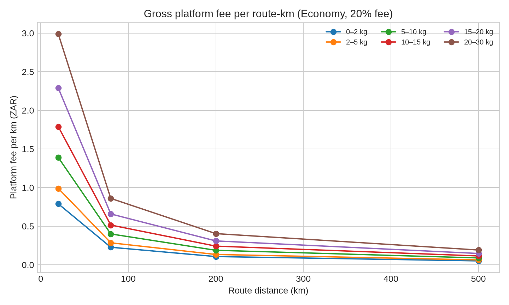

# Mzansi Couriers Pricing and Profitability Report

**Prepared:** 1 October 2026  
**Scope:** Customer tariff, fixed platform commission, courier allocation, route economics, payout aggregation, and scale recommendations.

## Executive conclusion

Mzansi Couriers now uses a **fixed 20% platform fee on every parcel charge**. The courier allocation is the remaining **80% of the parcel charge**. This is a gross allocation rule, not a guarantee that every route is profitable.

The current backend also estimates route operating cost at **R6.60 per route-kilometre** using its default assumptions:

- Fuel: **R2.60/km**. This equals 10 litres per 100 km at R26/litre.
- Driver compensation: **R2.50/km**.
- Vehicle allowance: **R1.00/km**.
- Route overhead: **R0.50/km**.

The route model adds a 25% minimum revenue margin. That produces a minimum viable route revenue target of **R8.25/km**.

The key commercial finding is that the 20% fee is predictable, but it is not automatically sufficient to pay all platform expenses. The platform will be commercially safe only when routes have enough parcels, when the 80% courier allocation is sustainable for the vehicle used, and when payment-processing, refunds, customer support, insurance, tax, and other overheads are separately measured.

## 1. The commission rule implemented in the backend

For every parcel:

```text
Customer charge = final tariff calculated by the pricing engine
Platform fee = customer charge × 20%
Courier allocation = customer charge × 80%
```

Example for a parcel charged at R139:

```text
Platform fee  = R139 × 20% = R27.80
Courier share = R139 × 80% = R111.20
```

The platform fee is calculated from the final customer price after route multipliers, urgency pricing, surcharges, and consolidation discounts.

The relevant implementation is `server/services/courier-pricing.ts`. The constant is `PLATFORM_FEE_PCT = 20`. Weekly courier candidates are created in `server/routers/payoutRouter.ts` using the courier allocation produced by the same route-economics service.

### What the 20% fee does and does not mean

The 20% is the platform’s **gross share of the parcel charge**. It is not the same as net profit. Net profit must still deduct:

- Paystack transaction costs.
- Refunds, failed payments, and chargebacks.
- Customer support and claims handling.
- Insurance or parcel-loss exposure.
- Software, hosting, messaging, mapping, and administration costs.
- Sales, marketing, tax, and compliance costs.

The current payout record stores the difference between customer revenue and courier payout as `platformCommission`. With the default 80% courier allocation, that difference is 20% of customer revenue before payment and business expenses.

## 2. How the customer price is calculated

The system does not use one universal price per kilometre. It calculates a tariff from several inputs:

```text
Billable weight = max(actual weight, volumetric weight)
Volumetric weight = length × width × height ÷ 5,000

Base tariff = weight band + service level
Route charge = base tariff × route multiplier − base tariff
Urgency premium = route-adjusted base × service premium
Surcharges = fragile + insurance + remote + oversized + manual handling
Final price = route-adjusted base + urgency premium + surcharges − discount
```

The weight bands are:

| Billable weight | Economy base | Express base |
|---:|---:|---:|
| 0–2 kg | R79 | R119 |
| 2–5 kg | R99 | R149 |
| 5–10 kg | R139 | R199 |
| 10–15 kg | R179 | R249 |
| 15–20 kg | R229 | R299 |
| 20–30 kg | R299 | R399 |
| Over 30 kg | Manual quote | Manual quote |

Priority uses the midpoint between Economy and Express as its tariff base and adds its own urgency multiplier. Express and Local Same Day use the Express base. Local Same Day is restricted to routes up to 100 km.

### Route multipliers

| Route band | Distance | Multiplier |
|---|---:|---:|
| Local | 0–30 km | 1.00 |
| Regional | 31–100 km | 1.15 |
| Long-distance | 101–300 km | 1.35 |
| Intercity | 301–600 km | 1.60 |
| Dynamic | More than 600 km | 1.85 |

The route multiplier means the system can produce a reasonable customer charge without publishing a simple per-kilometre rate. A derived per-kilometre figure can still be calculated for management reporting.

### Current surcharge values

| Condition | Surcharge |
|---|---:|
| Fragile | R25 |
| Insurance | R50 |
| Remote area | R75 |
| Oversized | R100 |
| Manual handling | R80 |

## 3. What the platform makes per parcel and per kilometre

The platform’s gross fee per parcel is always **20% of the final price**. The following table shows the Economy case before surcharges or discounts.

| Weight band | Local 20 km: customer / platform / courier | Regional 80 km: customer / platform / courier | Long-distance 200 km: customer / platform / courier | Intercity 500 km: customer / platform / courier |
|---|---:|---:|---:|---:|
| 0–2 kg | R79 / R15.80 / R63.20 | R90.85 / R18.17 / R72.68 | R106.65 / R21.33 / R85.32 | R126.40 / R25.28 / R101.12 |
| 2–5 kg | R99 / R19.80 / R79.20 | R113.85 / R22.77 / R91.08 | R133.65 / R26.73 / R106.92 | R158.40 / R31.68 / R126.72 |
| 5–10 kg | R139 / R27.80 / R111.20 | R159.85 / R31.97 / R127.88 | R187.65 / R37.53 / R150.12 | R222.40 / R44.48 / R177.92 |
| 10–15 kg | R179 / R35.80 / R143.20 | R205.85 / R41.17 / R164.68 | R241.65 / R48.33 / R193.32 | R286.40 / R57.28 / R229.12 |
| 15–20 kg | R229 / R45.80 / R183.20 | R263.35 / R52.67 / R210.68 | R309.15 / R61.83 / R247.32 | R366.40 / R73.28 / R293.12 |
| 20–30 kg | R299 / R59.80 / R239.20 | R343.85 / R68.77 / R275.08 | R403.65 / R80.73 / R322.92 | R478.40 / R95.68 / R382.72 |

The amount the platform makes **per route-kilometre** is not constant. It is calculated as:

```text
Gross platform fee per route-km = platform fee per parcel ÷ route distance
```

For example, a 2–5 kg Economy parcel produces:

- 20 km local: R19.80 ÷ 20 = **R0.99/km**.
- 80 km regional: R22.77 ÷ 80 = **R0.28/km**.
- 200 km long-distance: R26.73 ÷ 200 = **R0.13/km**.
- 500 km intercity: R31.68 ÷ 500 = **R0.06/km**.

This is why Mzansi should manage profitability by **corridor, route density, and parcels per trip**, not by looking only at the 20% fee on a single parcel.



## 4. Route scale required for both courier and platform

The backend’s default route-cost model is:

```text
Fuel cost/km       = 10 ÷ 100 × R26 = R2.60
Driver pay/km      = R2.50
Vehicle allowance  = R1.00
Route overhead/km  = R0.50
Total cost/km      = R6.60
Minimum target/km  = R6.60 × 1.25 = R8.25
```

The following examples show the number of parcels required for a route to meet the backend’s minimum viable revenue target. This is an operational target; it does not change the 20% commission rule.

| Route | Route cost | Minimum target revenue | 0–2 kg parcels needed | 2–5 kg parcels needed | 5–10 kg parcels needed |
|---|---:|---:|---:|---:|---:|
| 20 km local | R132 | R165 | 3 | 2 | 2 |
| 80 km regional | R528 | R660 | 8 | 6 | 5 |
| 200 km long-distance | R1,320 | R1,650 | 16 | 13 | 9 |
| 500 km intercity | R3,300 | R4,125 | 33 | 27 | 19 |

### Driver economics under the 80% allocation

The courier’s gross route allocation is 80% of parcel revenue. For an 80 km regional route with eight 0–2 kg Economy parcels:

```text
Customer revenue = 8 × R90.85 = R726.80
Platform fee     = R726.80 × 20% = R145.36
Courier payout   = R726.80 × 80% = R581.44
Route cost model = R528.00
```

The courier’s allocation is above the route cost model by **R53.44** before considering whether the actual vehicle is more or less efficient than the default assumptions. The platform’s gross fee is **R145.36** before payment and business expenses.

For a 20 km local route with only one 0–2 kg parcel:

```text
Customer revenue = R79.00
Platform fee     = R15.80
Courier payout   = R63.20
Route cost model = R132.00
```

That route is not viable under the current assumptions. The system correctly marks it for consolidation, but the current 20% fee rule does not itself prevent an uneconomic booking from being accepted or create an automatic minimum route charge.

## 5. Recommended profitable operating scale

The safest launch policy is to use the 20% fee as the contractual split, then impose route rules that protect both parties.

### Economy

Economy should dispatch only when the corridor reaches the minimum parcel count or the route revenue target. The minimum target should remain at **R8.25 per route-kilometre** until actual fuel, vehicle, claims, and courier data are available. Economy should use scheduled departures and consolidation rather than promising immediate collection.

### Priority

Priority should be priced above Economy and dispatched on the next viable route. It should not bypass route economics merely because its tariff is higher. The system should test whether the Priority surcharge covers the extra operational handling and service-level obligation.

### Express and Local Same Day

Express should require a dedicated-route or capacity-available check. A parcel should not be labelled Express if the platform has no verified courier capacity in the relevant corridor. The current code can mark Express as `dedicated-express`, but the operational workflow must still reserve capacity and record the extra cost.

### Suggested management targets by parcel band

These are practical operating targets derived from the current tariff and route-cost assumptions. They should be treated as guardrails, not as guaranteed earnings.

| Parcel band | Minimum customer price basis | Platform fee per parcel | Courier allocation | Recommended use |
|---|---:|---:|---:|---|
| 0–2 kg | R79 Economy | R15.80 | R63.20 | Local consolidation; avoid isolated long routes |
| 2–5 kg | R99 Economy | R19.80 | R79.20 | Core parcel band for regional routes |
| 5–10 kg | R139 Economy | R27.80 | R111.20 | Better route economics; verify vehicle capacity |
| 10–15 kg | R179 Economy | R35.80 | R143.20 | Use vehicle-space and volumetric checks |
| 15–20 kg | R229 Economy | R45.80 | R183.20 | Prefer planned routes and suitable vehicles |
| 20–30 kg | R299 Economy | R59.80 | R239.20 | Consider manual review for dense or awkward parcels |

## 6. Structural gaps and risks that still need work

### 6.1 The payout router aggregates by route but does not persist parcel-level commission detail

`buildWeeklyCandidates` groups completed deliveries and creates a route-level payout. It calculates customer revenue from delivery prices and calculates a courier offer from route economics. The database does not currently appear to store a permanent ledger row for each parcel containing:

- Customer amount charged.
- Exact 20% platform fee.
- Exact 80% courier allocation.
- Paystack transaction fee.
- Refund or chargeback reserve.
- Surcharge and discount allocation.
- Route identifier and corridor.

**Risk:** Finance cannot easily reconcile the parcel-level customer charge to the weekly courier transfer and the platform’s gross fee.

**Recommendation:** Add a `parcel_financial_ledger` table with immutable entries for charge, platform fee, courier share, payment cost, refunds, and settlement status.

### 6.2 The 20% fee is gross, not net profit

The platform fee currently does not automatically deduct Paystack, tax, refunds, support, claims, or software costs. The owner dashboard can therefore overstate profit if it labels the 20% amount as “profit.”

**Recommendation:** Name the current metric **Gross platform fee**. Add **Net platform contribution** only after all cost categories are posted.

### 6.3 Route viability and payout allocation are separate models

Route viability uses fuel, driver compensation, vehicle allowance, overhead, and a minimum margin. Courier payout uses 80% of customer revenue. These are intentionally separate after the requested change, but the system does not yet explain the difference clearly to administrators or couriers.

**Risk:** A route can be marked `consolidating` while the payment allocation still exists. A route can also be paid at 80% even if the vehicle’s real costs exceed the default assumptions.

**Recommendation:** Display both values:

```text
Courier contractual allocation: 80% of parcel revenue
Estimated route cost: backend cost model
Route status: consolidating / viable / dedicated express
```

### 6.4 Vehicle type and actual operating cost are not yet used in payout calculation

The backend currently uses default fuel consumption, fuel price, driver compensation, vehicle allowance, and overhead values. A small hatchback and a 3-ton vehicle can therefore be evaluated using the same cost assumptions unless a route input overrides them.

**Recommendation:** Store a verified operating profile per courier or vehicle, including fuel consumption, capacity, vehicle class, service area, and minimum acceptable route payout.

### 6.5 Per-kilometre reporting is derived, not contractual

The customer tariff is weight- and route-band-based. The platform does not earn a fixed amount per kilometre. Any per-kilometre number is a management ratio, and it changes with parcel weight, route distance, service level, discounts, and surcharges.

**Recommendation:** Report three separate ratios:

1. Gross customer revenue per route-km.
2. Gross platform fee per route-km.
3. Net platform contribution per route-km after payment and operating costs.

### 6.6 Over-30 kg and oversized parcels require stronger controls

The pricing engine throws a manual-quote error above 30 kg. Oversized volume can also add a surcharge, but there is no evidence in the current pricing layer that it reserves vehicle capacity or validates handling equipment.

**Recommendation:** Add a manual-quote workflow that records dimensions, loading method, vehicle requirements, liability limits, and an approved price before payment.

### 6.7 Discounts can reduce the fee and route viability

Consolidation discounts are applied before the 20% fee. This is commercially correct if the discount is intended to reduce customer revenue, but the system should make the effect visible. A discount can reduce the platform fee, courier allocation, and route revenue at the same time.

**Recommendation:** Show the pre-discount price, discount amount, final customer price, platform fee, and courier allocation in the admin audit trail.

### 6.8 Minimum payout thresholds can delay courier payment

The payout router skips candidates below the configured minimum payout amount. The current default logic checks a minimum payout threshold before creating a Paystack payout.

**Risk:** Couriers may interpret a delivered parcel as immediately payable even when the weekly route total is below the payout threshold.

**Recommendation:** Show “earned,” “held for weekly settlement,” and “eligible for Paystack transfer” as separate statuses.

### 6.9 Payment allocation needs reconciliation against Paystack settlement

The platform must distinguish the customer’s gross charge from the amount actually received after payment fees. It also needs idempotency for retries, webhook reconciliation, refunds, and chargebacks.

**Recommendation:** Reconcile each Paystack reference to one immutable parcel ledger entry and one settlement entry. Never calculate finance reports solely from the delivery table.

## 7. Recommended scale model for launch

A commercially safer rollout is corridor-based rather than courier-count-based.

### Phase 1: prove one corridor

Start with one local or regional corridor. Require at least the calculated parcel threshold before releasing an Economy route. Track actual kilometres, fuel, driver time, failed delivery time, and claims.

### Phase 2: establish observed cost bands

After at least 50–100 completed routes, replace default assumptions with observed cost ranges by vehicle class. Keep a conservative upper-percentile cost for viability decisions so the platform does not dispatch based on unusually cheap trips.

### Phase 3: introduce capacity-based Express

Only offer Express where the system can confirm a courier, vehicle capacity, collection time, and route cost. Charge the customer enough to cover the dedicated-route requirement while preserving the 20% platform allocation.

### Phase 4: manage contribution, not only commission

The owner dashboard should report:

```text
Gross parcel revenue
Gross platform fee at 20%
Payment-processing cost
Refund and chargeback reserve
Support and claims cost
Net platform contribution
Courier gross allocation at 80%
Courier estimated route cost
Courier estimated net before tax
```

## Final assessment

The fixed 20% commission rule is now clear and testable. The current tariff produces useful price separation by weight, route, and urgency. The main business risk is not the percentage itself. The risk is allowing the platform to treat a gross 20% fee as profit without a parcel-level settlement ledger and without enforcing route-level viability before dispatch.

The strongest next improvement is a **financial ledger plus corridor profitability dashboard**. That will show, for every parcel and every route, exactly what the customer paid, what the courier receives, what Paystack retained, what the platform keeps, and whether the route was actually profitable.

## References

1. `server/services/courier-pricing.ts` — Mzansi Couriers customer tariff and courier route economics implementation.
2. `server/services/relay-pricing.ts` — Mzansi Couriers relay pricing adapter and compatibility fields.
3. `server/routers/payoutRouter.ts` — Mzansi Couriers weekly courier payout aggregation and Paystack transfer workflow.
4. `server/payments/customer-payments.ts` — Mzansi Couriers customer checkout validation and expected payment amount.
5. `Pasted_content_02.txt` — Courier pricing specification and route-consolidation model supplied for implementation.
